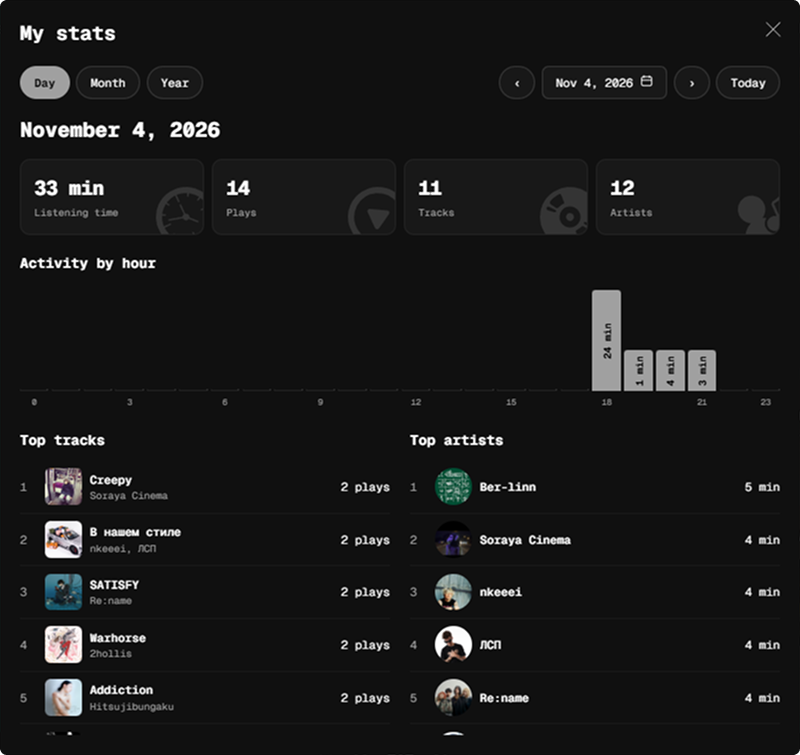

# Listening Stats

A [Spicetify](https://spicetify.app/) extension for daily, monthly and yearly listening stats. View your listening time, top tracks, top artists and activity charts from Spotify's top bar.



## Features

- Daily, monthly and yearly views with a custom date picker.
- Listening time, play count, distinct tracks and artists.
- Activity charts grouped by hour, day or month.
- Top 10 tracks ranked by plays, with album covers.
- Top 10 artists ranked by listening time, with avatars.
- Local storage and JSON export.
- Support for local music files. Ads and podcasts are excluded.

### Marketplace

Once the extension is listed, search for **Listening Stats** in Spicetify Marketplace, install it and reload Spotify when prompted.

### Manual installation

1. Download `listening-stats.js` from this repository.
2. Place it in your Spicetify `Extensions` folder. Run `spicetify path userdata` to find your Spicetify user folder, then open `Extensions` inside it.
3. Enable the extension:

```sh
spicetify config extensions listening-stats.js
spicetify apply
```

## Usage

Click the bar-chart icon in Spotify's top bar, or open **Profile menu > My stats**.

- Choose **Day**, **Month** or **Year** to change the reporting period.
- Click the date to open the calendar. Use its heading to switch between days, months and years.
- Use the arrows to move between periods, or **Today** to return to the current period.
- Hover over a chart bar for its listening time.
- Open **Profile menu > Export listening stats JSON** to download all collected stats.

## Uninstall

If installed through Marketplace, remove **Listening Stats** there.

For a manual installation:

```sh
spicetify config extensions listening-stats.js-
spicetify apply
```

Disabling or removing the extension does not delete its stored stats.

## Author

[Nullod](https://github.com/Nullod)
